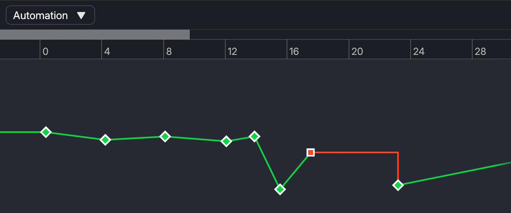
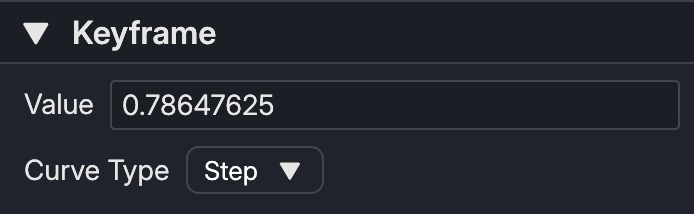

# Automation

The Automation panel lets you edit the automation when you have any Automation Node selected.

Selected keyframe is shown with yellow outline.

## Adding a Keyframe

You can add a keyframe by double-clicking using `LMB` in the Automation panel.

## Deleting a Keyframe

You can delete a keyframe by pressing the `delete` or `backspace` key in your keyboard when a keyframe is selected.

## Adjusting Value

To adjust the value or change the curve type of the keyframe, open the Inspector when a keyframe is selected.

In the Inspector, you'll see a section like below:

You can choose Linear and Step curve type using the dropdown list.
