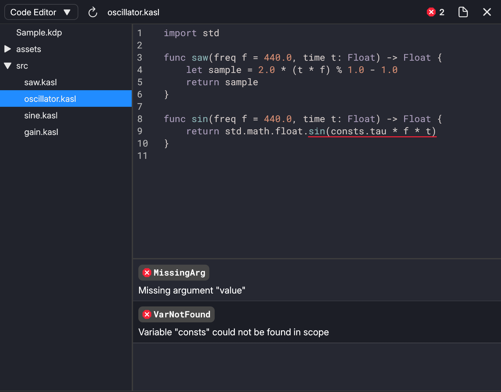
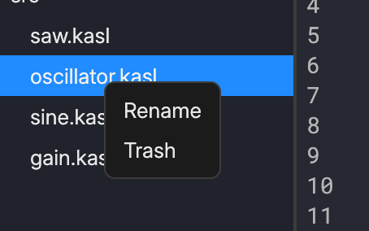
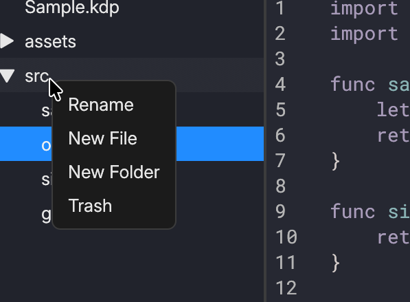
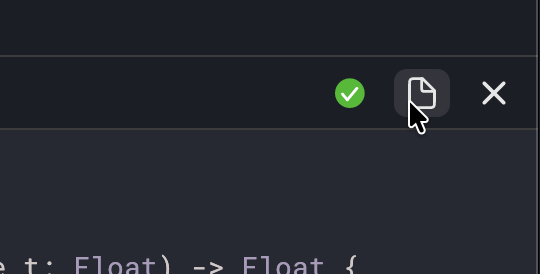

# Code Editor

The Code Editor is where you edit KASL files. You can also check errors in the editor.

On the left side, there is a browser where you can see all files in the project folder.

On the right side, there is an actual code editor where you edit the source code.

## Browser

### Creating, Renaming & Removing Files & Folders

Clicking the files and folders in the browser using `RMB` to rename or trash them.

To create a folder or a file, click on a folder using `RMB`:

### Refreshing Browser

You can refresh the browser using the refresh button at the top of the panel to update the browser.

## Editor

Syntax highlighting for KASL language is available in the editor. It currently does not support autocompletion.

### Saving File

To save a file, press `Ctrl+S` on Windows and Linux or `Cmd+S` on macOS.

You can also save only the currently opened file using the save button at the top-right of the panel.

### Check Errors

Click the errors button at the top-right of the panel to open or close the errors list.

To select the range where the error is happening, click the error in the errors list.

The errors are updated as you type.
