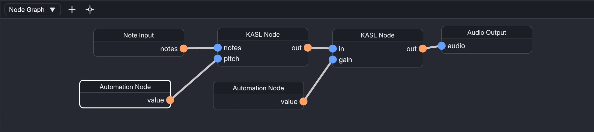

# Node Graph

The Node Graph is where you edit the node graph that belongs to each track.

## Editing

To add a node to the node graph, click the `+` button at the top of the panel.

Dragging from an output of a node to an input of another node creates a new connection.
Dragging from an input of the node removes the connection, or you can keep dragging to another input to change the destination of the connection.

## Jumping to a Node

You can jump to a random node using the button at the top of the panel.
