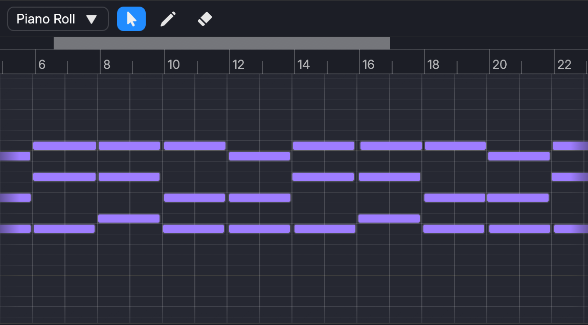

# Piano Roll

The Piano Roll is where you edit notes in a Note Region.

## Adding a Note

There are two ways to add a new note to the selected region:

- In 🐀Edit mode, double-click in the Piano Roll.
- In ✏️Insert mode, click in the Piano Roll.

## Deleting a Note

To remove a note from the region, press the `delete` or `backspace` key in your keyboard when a note is selected.

## Moving a Note

You can move notes freely by dragging notes using `LMB`.
