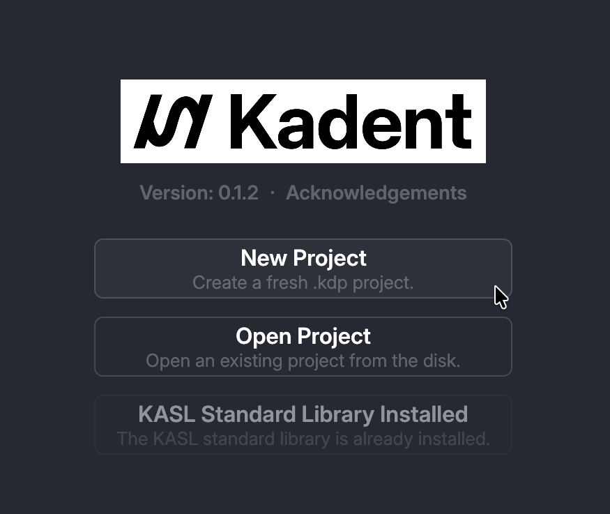
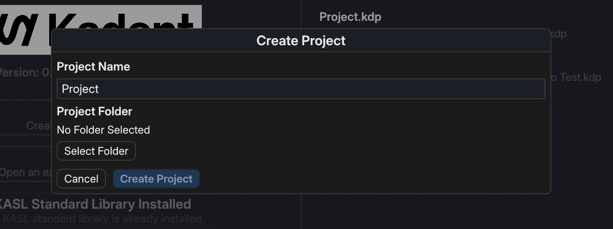

# Project

To start working in Kadent, create a new project or open an existing one.
A *project* is a folder that contains the project file with `.kdp` extension and other assets used in the project.

## Creating a Project

To create a new project, click "New Project" button in the splash screen.

When the button is clicked, a dialog like below appears.

In the dialog, you can choose the name and the location of project.
Clicking the "Create" button creates a new project and opens the created project.

## Opening an Existing Project

Clicking the "Open Project" button opens the file picker.
You can select a `.kdp` project file to open the project.

> [!NOTE]
> You cannot select a folder when opening a project. Select a project file whose filename ends with `.kdp` extension.
