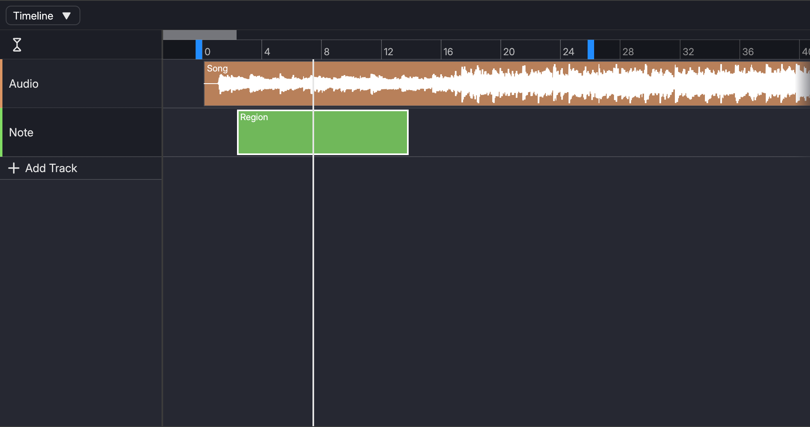
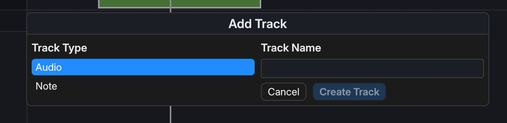

# Timeline

The Timeline is where you arrange regions to create your song.

There is a list of tracks on the left side, and the regions on the right side.

## Ruler

At the top of the regions area, the ruler shows the number of beats from the beginning of the project.

Clicking or dragging the ruler moves the playhead to that point.

## Adding Tracks

You can add a track by clicking "Add Track" button in the tracks list.

When you click the button, a dialog appears. You can pick the track's type and its name in the dialog.

Then click the "Create Track" button to create a track.

## Regions

In the regions area, double-click using `LMB` to create a new region to the track.

A empty note track is created when you click on a note track, and a zero-filled audio region is created when you click on a audio track.
