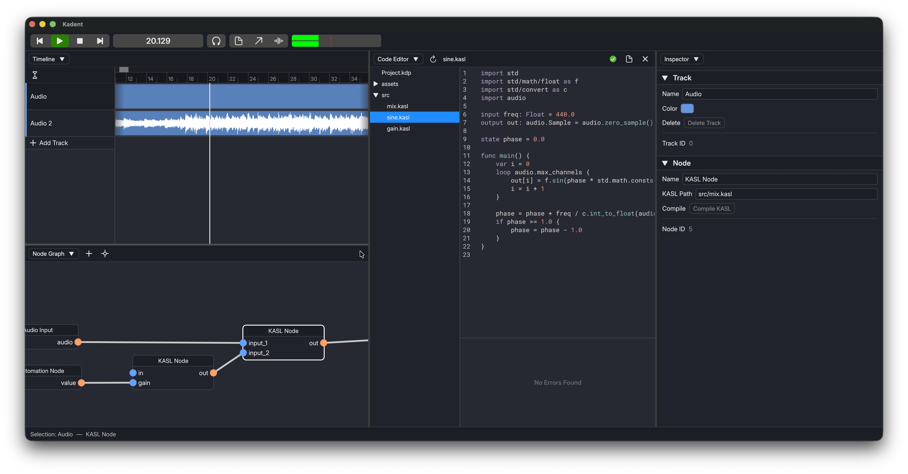
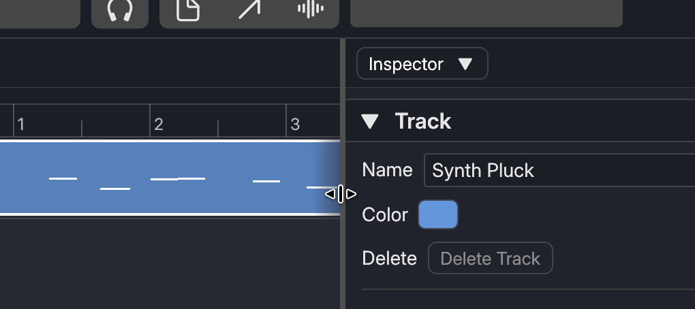
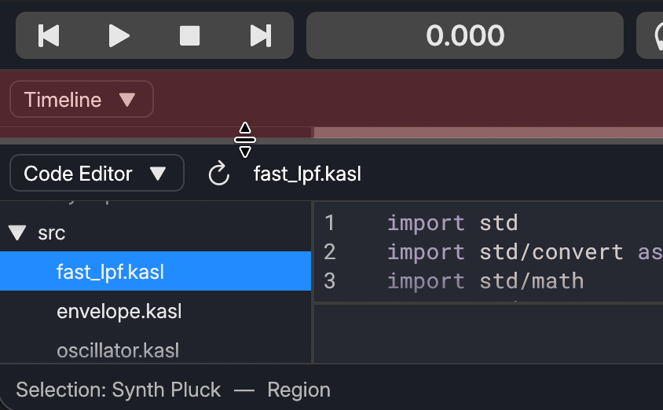
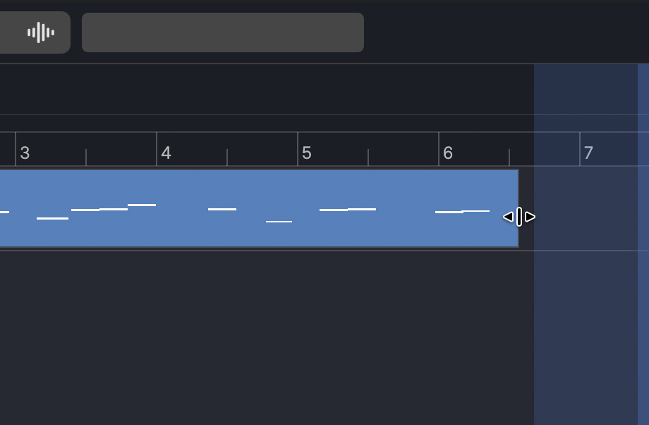

# Panel Management

In Kadent, you can open multiple panels at the same time.

## Resizing & Joining

Panels can be resized by dragging the borders using `LMB`.

To close the panel, drag the borders using `LMB` to make the panel small enough.
The panel to be closed will be displayed red.

## Splitting

Panels can be created by dragging from an edge of the panels with `LMB`.

Dragging from the left/right edge splits the panel vertically,
and dragging from the top/bottom edge splits the panel horizontally.
